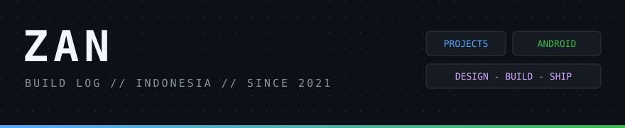
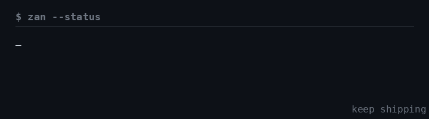

<p align="center">
  
</p>

<p align="center">
  <a href="https://discord.com/invite/vJ3TBfgbPy"></a>
  <a href="https://instagram.com/joharltf"></a>
  <a href="https://facebook.com/joharltf"></a>
</p>

<p align="center">
  
</p>

### WHO

```yaml
user: zan
handle: joharltf
base: Indonesia
since: 2021
focus: ports, tools and mobile builds
flow: idea -> design -> build -> test -> ship
```

### WORK

<!-- PROJECTS:START -->
<p align="center">
  <a href="https://github.com/joharltf/Zan-OoT3D-Mobile"><b>Zan-OoT3D-Mobile</b></a><br />
  <sub>Public prebuild APK releases for Zan - Ocarina of Time 3D Mobile</sub>
</p>

<p align="center">
  <a href="https://github.com/joharltf/Zan-Previews"><b>Zan-Previews</b></a><br />
  <sub>Public preview images for Zan game releases</sub>
</p>
<!-- PROJECTS:END -->

### TOOLS

<p align="center">
  
  
  
  
  
  
  
  
  
  
  
  
  
  
</p>

### SIGNAL

<p align="center">
  
</p>

<p align="center">
  
</p>

<p align="center"><sub>contribution snake · refreshed every 12 hours</sub></p>
